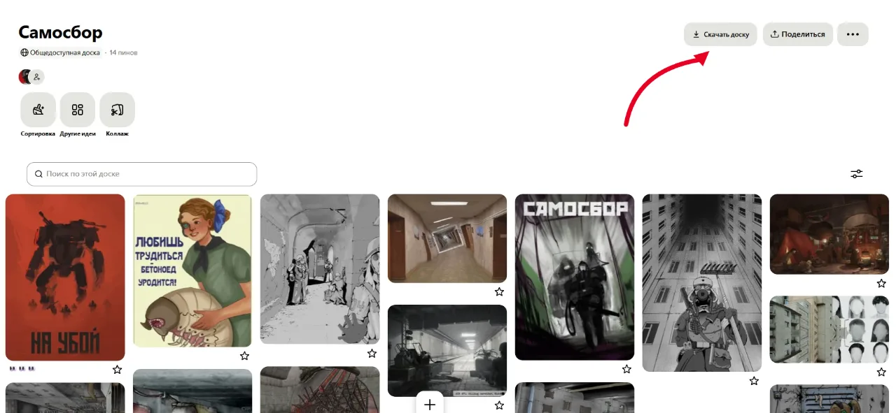
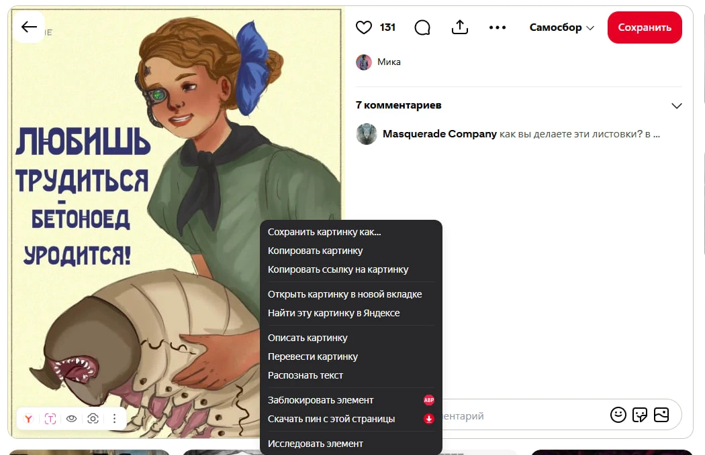
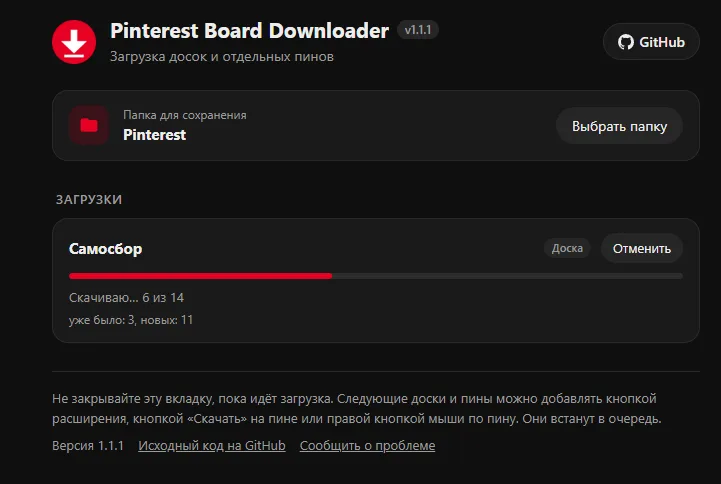

# Pinterest Board Downloader

Расширение для браузера, которое скачивает **доски и отдельные пины Pinterest**:
картинки в оригинальном размере, видео, карусели и story-пины.

- Файлы пронумерованы **в том же порядке, что и на доске**: `0001_…`, `0002_…`.
- Разделы доски сохраняются в отдельные подпапки.
- В подпапке `_галерея` лежит `index.html`. Если его открыть, доска покажется так же, как на сайте, вместе с видео.
- При повторном скачивании доски докачиваются только новые пины.
- Отдельный пин можно скачать кнопкой «Скачать» прямо на пине, по ссылке или через меню правой кнопки мыши.

Настраивать ничего не нужно: расширение работает в вашем браузере, просто войдите в нужный аккаунт Pinterest и всё.
Оно не отправляет и не сохраняет данные никуда, кроме самого Pinterest и вашего компьютера.

**Браузеры:** Chrome, Edge, Яндекс Браузер, Opera. В Firefox и Safari не работает.


## Установка

1. Скачайте архив `pinterest-board-downloader-<версия>.zip` со страницы
   [Releases](../../releases/latest).
2. Распакуйте его в постоянное место, например `Документы\pinterest-board-downloader`.
   > Не удаляйте и не перемещайте эту папку после установки: браузер загружает расширение прямо из неё.
3. Откройте страницу расширений, вставив адрес в адресную строку:

   | Браузер | Адрес |
   |---|---|
   | Chrome, Opera | `chrome://extensions` |
   | Edge | `edge://extensions` |
   | Яндекс Браузер | `browser://extensions` |

4. Включите **«Режим разработчика»** (переключатель справа вверху; в Edge он слева внизу).
5. Нажмите **«Загрузить распакованное расширение»** и выберите распакованную папку,
   ту, в которой лежит файл `manifest.json`.
6. Нажмите на значок пазла 🧩 рядом с адресной строкой и закрепите **Pinterest Board Downloader**,
   чтобы красная кнопка всегда была на виду.

Браузер может показывать предупреждение о расширениях в режиме разработчика.
Так бывает со всеми расширениями, установленными из папки, это нормально.


## Как пользоваться

### Скачать доску

Откройте доску на pinterest.com (или раздел доски), затем:

- нажмите **«⬇ Скачать доску»** в шапке доски, рядом с кнопкой «Поделиться»;
- или нажмите красную кнопку расширения, затем **«Скачать эту доску»**.



### Скачать отдельный пин

Есть четыре способа:

- **Кнопка «Скачать» на самом пине.** Наведите мышь на пин в ленте, на доске или на странице пина:
  в левом нижнем углу появится красная кнопка **«⬇ Скачать»**.
- **Правой кнопкой мыши** по пину на любой странице Pinterest → **«Скачать этот пин»**.
  На странице самого пина пункт называется **«Скачать пин с этой страницы»**.
- Откройте пин и нажмите кнопку расширения, затем **«Скачать этот пин»**.
- **По ссылке:** нажмите кнопку расширения, вставьте ссылку в поле **«Ссылка на пин или доску»**
  и нажмите **«Скачать»**. Подходят обычные ссылки, короткие ссылки `pin.it/…` из приложения,
  а также ссылки на доски.

Эти пины сохраняются в папку `Отдельные пины`. Имя файла состоит из названия пина и его id.



### Первый запуск: выбор папки

После нажатия на кнопку откроется **вкладка загрузок**. В первый раз:

1. Нажмите **«Выбрать папку»**.
2. Создайте новую папку, например `Pinterest`, и выберите её.
   Сами папки «Загрузки» и «Рабочий стол» браузер выбрать не даёт, нужна папка внутри них.
3. Разрешите расширению изменять файлы в ней. Чтобы браузер больше не спрашивал,
   выберите **«Разрешать при каждом посещении»**.

Дальше всё скачивается само.
Не закрывайте вкладку загрузок, пока не появится **«Готово»**.
Пока идёт загрузка, можно добавлять следующие доски и пины, они встанут в очередь.
Очередь видна во вкладке загрузок. Номер показывает, что скачается следующим, а порядок можно менять,
перетаскивая строки мышью. Всё, что ещё не началось, можно **«Убрать»**, а текущую загрузку можно
**«Отменить»**. Тогда сразу начнётся следующая, а уже скачанные файлы останутся в папке.
Будьте внимательны с выбором места для скачивания, поскольку пины почти всегда скачиваются в оригинальном качестве - доска на несколько тысяч пинов может весить больше гигабайта.




## Что получится

```
<ваша папка>\
├─ <автор> - <доска>\
│  ├─ 0001_<id пина>.jpg
│  ├─ 0002_<id пина>.mp4
│  ├─ 0003_<id пина>_01.jpg      ← карусель или story-пин из нескольких файлов
│  ├─ 0003_<id пина>_02.jpg
│  ├─ _галерея\
│  │  ├─ index.html              ← просмотр доски, как на сайте
│  │  └─ pins.json               ← список пинов со ссылками
│  └─ 1 <раздел>\
│     ├─ 0001_<id пина>.jpg
│     └─ _галерея\…
└─ Отдельные пины\
   └─ <название пина> - <id пина>.mp4
```

## Повторное скачивание доски

Если скачать ту же доску в ту же папку ещё раз, расширение сверит папку с доской:

- уже скачанные пины **не скачиваются заново**, а только перенумеровываются под новый порядок доски;
- скачиваются только новые пины;
- файлы пинов, которые вы убрали с доски, переносятся в подпапку `_убраны с доски`. Ничего не удаляется.

Уже скачанные отдельные пины тоже не скачиваются повторно.


## Если что-то не так

| Проблема | Что делать |
|---|---|
| Найдено мало пинов | Войдите в аккаунт Pinterest и нажмите кнопку ещё раз. |
| Во вкладке загрузок появилась кнопка «Продолжить» | Браузер просит заново подтвердить доступ к папке, нажмите её один раз. |
| Загрузка остановилась на одном файле | Если сервер Pinterest перестал отвечать, расширение само повторит файл до трёх раз, а потом отметит его в «Что не скачалось» и пойдёт дальше. Если ждать не хочется, нажмите «Отменить»: следующая загрузка начнётся сразу. |
| Загрузка встала и ничего не происходит | Перезагрузите вкладку загрузок (F5). Загрузка начнётся заново, но уже скачанные файлы пропустятся, поэтому докачается только остаток. |
| Какие-то файлы не скачались | Их список есть во вкладке загрузок под «Что не скачалось». Скачайте доску ещё раз, и расширение попробует скачать только их. |
| Видео сохранилось как `.ts`, а не `.mp4` | У этого видео на Pinterest нет mp4-версии. Файл `.ts` открывается в VLC и большинстве плееров. |
| Нет кнопки «Скачать» на пинах, кнопки «Скачать доску» в шапке доски или пункта «Скачать этот пин» в меню правой кнопки | Обновите страницу Pinterest (F5): после установки или обновления расширения уже открытые вкладки его не видят. Меню правой кнопки вызывайте прямо по картинке пина. |

## Обновление

1. Скачайте новый архив со страницы [Releases](../../releases/latest).
2. Замените файлы в папке расширения новыми.
3. На странице `chrome://extensions` нажмите круглую стрелку ↻ на карточке расширения.
4. Обновите вкладку Pinterest.
